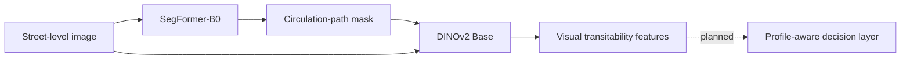
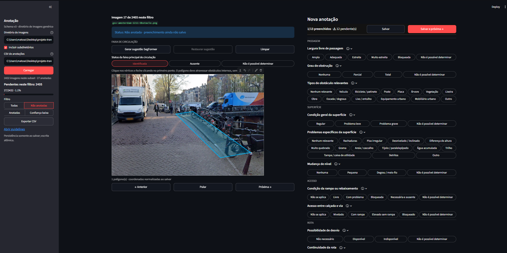
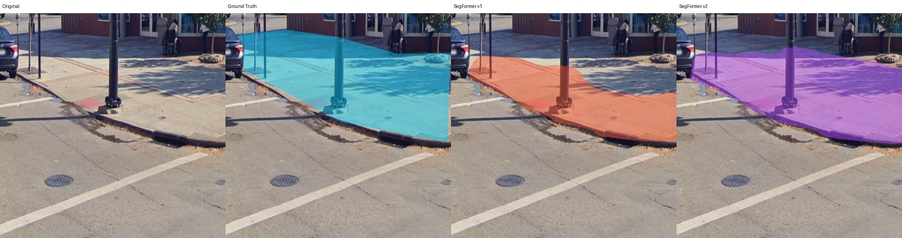

# Urban Transitability with Computer Vision

[](pyproject.toml)
[](tests)


A computer-vision project for extracting accessibility-related information from
street-level imagery. The repository provides a local annotation tool,
reproducible dataset checks, a SegFormer circulation-path segmenter, and an
experimental DINOv2 multi-task classifier.

The software is intended for research and prototyping. Predictions can be wrong
and must not be treated as a definitive accessibility assessment or as a
substitute for an on-site evaluation.

## Overview

The current pipeline separates two visual questions:

1. **Where is the circulation path?** SegFormer predicts the image region where
   pedestrian circulation is expected.
2. **What are the visible conditions of that region?** DINOv2 predicts properties
   such as passage width, obstruction, surface condition, level change, route
   continuity, obstacle types, and surface problems.

The repository also retains the earlier **MVP0** pipeline. That experiment uses
a ResNet18 to detect seven obstacle labels and a fixed heuristic to produce
one of three Portuguese transitability classes:

- **Transitável** — only low-impact features, or no detected feature;
- **Parcialmente transitável** — at least one moderate-impact feature;
- **Não transitável** — at least one high-impact feature.

This three-level decision rule is implemented only for the legacy MVP0. A
profile-aware decision layer for the SegFormer + DINOv2 pipeline is not yet
implemented.



## Visual Demo

The annotation interface stores normalized circulation-path polygons together
with structured accessibility properties. A SegFormer suggestion can be loaded
into the editor, reviewed, corrected, and saved by the annotator.



The comparison below uses a real frozen test sample. It shows the original
image, human ground truth, SegFormer v1, and SegFormer v2.



The DINOv2 baseline currently exposes structured JSON predictions through its
CLI. Its evaluated results are reported below; no synthetic classification
visualization is used in this README.

## Features

- **Generic local annotation tool** built with Streamlit. It accepts any image
  directory and does not assume that every Project Sidewalk subset is present.
- **Versioned annotation schema** with single-label, multi-label, spatial, and
  confidence fields.
- **Editable circulation-path polygons** stored as normalized coordinates.
- **Optional SegFormer assistance** that never persists a prediction without an
  explicit human save.
- **Atomic CSV persistence**, schema validation, duplicate detection, filtering,
  and export.
- **SegFormer-B0 training and inference** for binary circulation-path
  segmentation.
- **DINOv2 Base multi-task baseline** with a frozen backbone and independent
  categorical and multi-label heads.
- **Panorama-aware deterministic splits** to prevent related images from
  crossing train, validation, and test sets.
- **Dataset QA, metrics, prediction exports, and error-analysis artifacts**.
- **Legacy MVP0 inference** with ResNet18, per-label thresholds, a three-level
  heuristic, and a generated justification.

## How It Works

### Annotation and dataset

The pilot contains 200 annotated Project Sidewalk images:

- 192 records have an annotated `circulation_path`;
- 8 records are marked `unknown` and are excluded from segmentation and
  DINOv2 training;
- all records use annotation schema version 3.

The schema defines 12 human-reviewed properties. Eleven are potential model
outputs; `annotation_confidence` is metadata only. The first DINOv2 baseline
models seven property groups:

- `passage_width`
- `obstruction`
- `surface_condition`
- `level_change`
- `path_continuity`
- `obstacle_type`
- `surface_obstacle`

The remaining schema properties are annotated but are not outputs of the current
DINOv2 baseline.

### Segmentation

SegFormer-B0 is initialized from
`nvidia/segformer-b0-finetuned-cityscapes-1024-1024` and fine-tuned as a
two-class segmenter:

- `0`: background;
- `1`: circulation path.

The model is selected exclusively by foreground IoU on validation data. The
frozen test set is evaluated only after checkpoint selection.

### Feature classification

The DINOv2 baseline uses `facebook/dinov2-base` with:

- a frozen ViT-B/14 backbone;
- the 768-dimensional CLS token;
- one head per annotated property group;
- class weights computed from the training split;
- validation-selected thresholds for multi-label heads.

The circulation region remains unchanged while the surrounding context is
darkened, desaturated, and blurred before classification.

## Quick Start

### Requirements

- Python 3.10 or newer;
- the dependencies declared in [`pyproject.toml`](pyproject.toml);
- local dataset images for annotation, training, or inference;
- local checkpoints for inference.

CUDA is optional for the annotation tool and inference, which fall back to CPU.
The current SegFormer and DINOv2 training scripts require CUDA.

Raw images, generated image processors, and model checkpoints are intentionally
ignored by Git. Reports and split definitions are versioned, but a fresh clone
does not include trained weights.

### Install

From the repository root:

```bash
python -m venv .venv
python -m pip install --upgrade pip
python -m pip install -e .
```

Activate the virtual environment using the command appropriate for your shell
before installing or running the project.

### Run the annotation tool

```bash
python -m streamlit run tools/annotation_app/app.py
```

The tool defaults to:

- images: `data/obstacles/crops`;
- annotations: `annotations/transitability_annotations.csv`.

Both paths can be changed in the interface. See the
[annotation tool guide](tools/annotation_app/README.md) for the complete workflow.

### Run dataset QA

```bash
python -m ml.segmentation.qa
```

The default report is written to `artifacts/segmentation/dataset_qa.md`.

### Run SegFormer inference

```bash
python -m ml.segmentation.predict \
  --image path/to/image.png \
  --checkpoint artifacts/segmentation/v2/best_segformer.pt \
  --output-dir outputs/segmentation
```

This writes a binary mask and an overlay. To use the v1 checkpoint, omit the
`--checkpoint` argument.

### Run DINOv2 inference

DINOv2 requires an image and either a binary mask or normalized polygon:

```bash
python -m ml.dinov2.predict \
  --image path/to/image.png \
  --mask outputs/segmentation/image_circulation_path_mask.png \
  --checkpoint artifacts/dinov2/v1/best_dinov2_multitask.pt
```

The command prints categorical predictions, multi-label predictions,
probabilities, and the validation-selected thresholds as JSON.

### Run the legacy MVP0

When `best_model.pt` is available at the repository root:

```bash
python -m ml.predict path/to/image.png
```

This is the only current command that produces the three-level transitability
classification and Portuguese justification.

### Run tests

```bash
python -m unittest discover -v
```

The current suite contains 83 tests covering annotation persistence, schema
validation, dataset loading, split isolation, segmentation utilities, DINOv2
heads and metrics, MVP0 inference, and transitability rules.

## Training

Training expects the local pilot images and annotation CSV described in the
documentation.

### SegFormer

```bash
python -m ml.segmentation.train
python -m ml.segmentation.train_v2
```

The v2 run preserves the v1 validation and test sets and writes separate
artifacts under `artifacts/segmentation/v2/`.

### DINOv2

Inspect and split the dataset without training:

```bash
python -m ml.dinov2.train --prepare-only
```

Run the baseline training:

```bash
python -m ml.dinov2.train
```

Training uses validation data for checkpoint selection and multi-label threshold
selection. Test data is evaluated only after those choices are frozen.

## Models and Evaluation

### SegFormer

Both versions use the same 15 validation and 15 test images. SegFormer v2 adds
all newly annotated valid masks to the training set.

| Model | Train / validation / test | Foreground IoU | Dice | Precision | Recall |
|---|---:|---:|---:|---:|---:|
| SegFormer v1 | 75 / 15 / 15 | 0.4517 | 0.6223 | 0.6125 | 0.6324 |
| SegFormer v2 | 162 / 15 / 15 | **0.5572** | **0.7157** | **0.6460** | **0.8023** |

The best v2 checkpoint was selected at epoch 14 with validation IoU 0.5845 and
validation Dice 0.7378. The recorded history shows an overfitting signal after
that epoch; early stopping prevented later epochs from replacing the checkpoint.

See the full [v1/v2 comparison](artifacts/segmentation/v2/comparison_v1_v2.md).

### DINOv2 baseline

The evaluated split contains 134 training, 29 validation, and 29 test images.
The test aggregate macro F1 is **0.2773**.

| Head | Test macro F1 |
|---|---:|
| Surface condition | 0.4469 |
| Path continuity | 0.3435 |
| Passage width | 0.2632 |
| Level change | 0.2500 |
| Surface obstacles | 0.2281 |
| Obstacle types | 0.2215 |
| Obstruction | 0.1880 |

This is an exploratory baseline, not a production model. The best validation
result occurred at epoch 2, followed by overfitting. Several labels have only
one or two positive examples, and some have none in the current pilot. Per-head
metrics should therefore be interpreted together with class support.

See the [dataset analysis](artifacts/dinov2/v1/dataset_analysis.md),
[test metrics](artifacts/dinov2/v1/test_metrics.json), and
[error analysis](artifacts/dinov2/v1/error_analysis.md).

## Project Structure

```text
annotations/                 Schema, guidelines, and human annotations
artifacts/                   Versioned reports, splits, metrics, and histories
data/annotation-pilot/       Reproducible pilot metadata; images remain local
docs/                        Design notes, progress reports, diagrams, and assets
ml/data/                     Legacy obstacle dataset loading
ml/segmentation/             SegFormer dataset, training, QA, and inference
ml/dinov2/                   DINOv2 dataset, model, losses, metrics, and inference
ml/*.py                      Legacy ResNet18 MVP0 pipeline
scripts/                     Dataset inspection, pilot construction, and analysis
tools/annotation_app/        Streamlit annotation application
tests/                       Unit and integration-oriented tests
```

Generated checkpoints and visual outputs are excluded by
[`.gitignore`](.gitignore). CSV, JSON, and Markdown experiment reports remain
available for review.

## Documentation

- [Annotation tool guide](tools/annotation_app/README.md)
- [Annotation guidelines](annotations/annotation-guidelines.md)
- [Annotation schema](annotations/annotation-schema.yaml)
- [Technical progress report](docs/progress/2026-10-30.md)
- [SegFormer v1/v2 comparison](artifacts/segmentation/v2/comparison_v1_v2.md)
- [DINOv2 dataset analysis](artifacts/dinov2/v1/dataset_analysis.md)
- [DINOv2 error analysis](artifacts/dinov2/v1/error_analysis.md)
- [Requirements document](docs/documento-requisitos.md)
- [MVP modeling notes](docs/modelagem-mvp.md)
- [References](docs/referencias.md)

## Roadmap

Current engineering priorities are:

- improve DINOv2 generalization and evaluate alternatives to a fully frozen
  backbone;
- collect targeted examples for rare and unsupported labels;
- determine which accessibility properties can be inferred reliably from a
  single image;
- implement and validate a profile-aware decision layer for the current
  SegFormer + DINOv2 pipeline;
- define a reproducible checkpoint distribution strategy.

Collaborative maps, route planning, mobility profiles, APIs, and personalized
navigation are not implemented in the current repository. They remain possible
later-stage applications rather than current features.

## Contributing

Contributions should remain small, testable, and consistent with the current
experiment boundaries.

1. Create a focused branch.
2. Preserve annotation schema compatibility and frozen evaluation splits unless
   a change explicitly introduces a new experiment version.
3. Add or update tests for behavioral changes.
4. Run `python -m unittest discover -v`.
5. Document any new command, artifact format, or data requirement.

Do not commit raw datasets, generated checkpoints, or personally identifying
street imagery outside the repository's established data policy.

## License

This repository does not currently include a license file. A license still needs
to be selected by the maintainers; do not assume MIT, Apache, or another
open-source license until that decision is recorded.

## Origin and Acknowledgments

The project originated in the *Projeto Transformador I* course in the Computer
Science program at PUCPR and has evolved into an experimental urban-accessibility
computer-vision codebase.

The pilot data is derived from Project Sidewalk datasets. Model baselines use
SegFormer and DINOv2 through the Hugging Face Transformers ecosystem, and the
legacy MVP0 uses torchvision's ResNet18.
