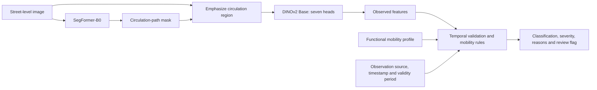

# Mobiliza · Urban Transitability with Computer Vision

Mobiliza extracts circulation conditions from street-level images and evaluates
transitability against functional mobility requirements. It combines SegFormer,
DINOv2, explicit mobility rules and temporal validation through a FastAPI service.
The objective is an explainable image-to-assessment prototype, not a definitive
accessibility or safety assessment. Predictions do not replace on-site evaluation.

[Architecture](#architecture) · [Results](#models-and-results) ·
[Installation](#installation) · [API](#rest-api) · [Modal](#modal-deployment) ·
[Tests](#tests) · [Limitations](#limitations)

## Architecture



SegFormer locates the structural circulation region, rather than a personalized
route around obstacles. DINOv2 classifies its visible conditions: the region is
preserved while surrounding context is darkened, desaturated and blurred. Its
saved processor resizes the shortest edge to 256, center-crops to 224×224 and
applies ImageNet normalization. The rule engine compares five categorical
predictions with a functional profile. Multilabel predictions enrich reasons but
cannot independently decide transitability. Temporal validation prevents outdated
or undated observations from supporting decisions.

[ml/pipeline.py](ml/pipeline.py) exposes `observe_scene()`, `apply_profile()` and
`infer_transitability()`. FastAPI reuses them, loading models once per process
and applying up to eight profiles without repeating perception. There is no
database, persisted upload store, map or routing service in this repository.

## Visual examples

The annotation editor combines editable polygons and structured properties.
Suggestions become ground truth only after human review and an explicit save.


Historical segmentation comparison: original, human mask, SegFormer v1 and v2.
This illustrates the earlier experiment, not the current common-split checkpoint.


## Dataset and methodology

The pilot contains **200 manually reviewed Project Sidewalk images**: 80 Obstacle,
70 SurfaceProblem and 50 CurbRamp. **192 have valid circulation-path annotations**;
8 with `circulation_path_status=unknown` are excluded from both model datasets.
Schema version 3 records visual properties, normalized polygons, original image
dimensions, annotation origin and confidence. Annotation time is not capture time.

The common split is **134 train / 29 validation / 29 test**, isolated by image
and panorama. Assignments are copied directly from the frozen
[DINOv2 v1 split](artifacts/dinov2/v1/splits.csv). Only train adjusts weights;
validation selects checkpoints; training runs evaluate test after restoring the
selected checkpoint.

No common-test image trained or validated either current model. However, these
results were inspected during development: this is **not a completely blind final
holdout**. The older pipeline sensitivity study used a SegFormer trained on 27 of
the 29 DINO test images; it is retained as sensitivity analysis, not independent
end-to-end evidence.

Source specifications: [schema](annotations/annotation-schema.yaml),
[human annotations](annotations/transitability_annotations.csv),
[annotation guidelines](annotations/annotation-guidelines.md) and
[pilot manifest](data/annotation-pilot/pilot_manifest.csv). The guidelines retain
a v2 heading; the YAML/CSV include later v3 spatial-origin fields. The pilot
summary is a snapshot of initial selection, not current annotation completion.
Images and trained weights remain local; splits, configurations, histories,
metrics and negative results are preserved in `artifacts/`.

### Annotation workflow

After the development installation below:

```bash
python -m streamlit run tools/annotation_app/app.py
```

Select any image directory, recursion option and annotation CSV. Resume the pilot
with `data/annotation-pilot/images` and `annotations/transitability_annotations.csv`.
Set circulation status, draw/edit the normalized polygon, fill properties and
save. Existing annotations open read-only until explicitly edited. The editor
supports filtering, CSV export, coherence warnings and atomic persistence without
modifying original images. No particular Project Sidewalk subset is required.

Optional SegFormer assistance uses the editor's historical v1 checkpoint,
`artifacts/segmentation/best_segformer.pt`. It runs only on request and requires
human approval before saving. Manual annotation works without this checkpoint.

## Models and results

### SegFormer

SegFormer-B0 starts from
`nvidia/segformer-b0-finetuned-cityscapes-1024-1024`, with two classes
(background / circulation path) and 512×512 inputs. Configuration: Cross Entropy
+ Dice, AdamW, LR `6e-5`, weight decay `0.01`, batch 4, AMP, seed 42, maximum
30 epochs, patience 5. Selection uses validation foreground IoU, with validation
loss as tie-breaker. Each experiment starts from the base checkpoint.

| Experiment | Train / val / test | Test IoU | Dice | Precision | Recall |
|---|---:|---:|---:|---:|---:|
| v1 | 75 / 15 / 15 | 0.4517 | 0.6223 | 0.6125 | 0.6324 |
| v2 | 162 / 15 / 15 | 0.5572 | 0.7157 | 0.6460 | 0.8023 |
| Common DINO split, current | 134 / 29 / 29 | 0.5222 | 0.6861 | 0.6816 | 0.6907 |

The current checkpoint was selected at **epoch 14**, validation IoU **0.6565**
and Dice **0.7927**. V1/v2 share a 15-image test; the common run has a different
29-image test, so its difference is not an isolated model improvement/regression.
Sources: [v1/v2 comparison](artifacts/segmentation/v2/comparison_v1_v2.md),
[common-split comparison](artifacts/segmentation/common-dino-split/comparison_previous_v2.md).

### DINOv2

The current **v2-partial** uses `facebook/dinov2-base` (ViT-B/14), a 768-dimensional
CLS representation and seven `Dropout(0.30) → Linear` heads. Epochs 1–2 freeze
the backbone; subsequently only the final two encoder blocks and final
normalization are trainable. The frozen ablation keeps the backbone frozen.

Categorical heads and values:

- `passage_width`: `wide`, `adequate`, `narrow`, `very_narrow`, `blocked`;
- `obstruction`: `none`, `partial`, `full`;
- `surface_condition`: `regular`, `minor_problem`, `major_problem`;
- `level_change`: `none`, `minor`, `step`;
- `path_continuity`: `continuous`, `restricted`, `interrupted`.

Multilabel heads retain targets with at least 10 training positives:

- `obstacle_type`: `pole`, `sign`, `tree`, `vegetation`, `construction`,
  `litter_debris`, `utility`;
- `surface_obstacle`: `cracks`, `bumpy`, `uneven_slanted`, `height_difference`,
  `very_broken`, `grass`, `sand_gravel`.

Other labels remain in the schema, explicitly reported as not modeled with
support counts; they are not merged into `other`. See
[targets.json](artifacts/dinov2/v2/partial/targets.json).

Training uses equal head weights, categorical Cross Entropy with smoothing
`0.05` and square-root inverse-frequency weights, and multilabel BCE with
`sqrt(negative/positive)` weights capped at 8. AdamW: heads LR `1e-4`, decay `0.01`;
backbone LR `1e-5`, decay `0.05`. Other settings: batch 8, AMP, clipping 1.0,
seed 42, two warm-up epochs, cosine decay, maximum 30 epochs, patience 5.
Checkpoint selection uses validation aggregate macro F1. Current v2 multilabel
thresholds are **0.5**, not the legacy MVP0 calibration. Aggregate macro F1 is
the unweighted mean of seven head macro F1 scores.

| Experiment with human masks | Test aggregate macro F1 |
|---|---:|
| v1 on v2 targets, threshold 0.5 | 0.3170 |
| v2-frozen | 0.2682 |
| v2-partial, current | 0.3762 |

Partial gains **0.0592** over v1 on common targets and **0.1081** over frozen.
Frozen did not improve the baseline. Original v1 macro F1 **0.2773** uses its
full targets and calibrated thresholds, so it is not directly comparable here.
Partial's best checkpoint is **epoch 10**, validation aggregate macro F1 **0.3290**.
Train loss **0.4417** versus validation loss **1.2863** indicates a remaining
generalization gap; partial fine-tuning did not eliminate overfitting.
Sources: [configuration](artifacts/dinov2/v2/partial/training_config.json),
[test metrics](artifacts/dinov2/v2/partial/test_metrics.json),
[common-target comparison](artifacts/dinov2/v2/partial/comparison_v1_common.json),
[v1 dataset analysis](artifacts/dinov2/v1/dataset_analysis.md).

### End-to-end evaluation

Paired evaluation on the same 29 common-test images and DINO checkpoint changes
only the circulation mask:

| Head | Human mask macro F1 | SegFormer mask macro F1 |
|---|---:|---:|
| `passage_width` | 0.2500 | 0.1817 |
| `obstruction` | 0.4729 | 0.2577 |
| `surface_condition` | 0.4872 | 0.4725 |
| `level_change` | 0.3598 | 0.3532 |
| `path_continuity` | 0.4824 | 0.2481 |
| `obstacle_type` | 0.2828 | 0.2444 |
| `surface_obstacle` | 0.2987 | 0.3660 |
| **Aggregate** | **0.3762** | **0.3034** |

The decrease is **0.0729**, or 19.4% relative (before rounding). Multilabel micro
F1 changes from 0.4151 to 0.3929 for obstacles and 0.3544 to 0.4198 for surface
problems. There are 28 correct→wrong and 20 wrong→correct decisions; five images
preserve all decisions. These measure visual features, not personalized
transitability accuracy. [Paired report](artifacts/pipeline-evaluation/common-split-dinov2-partial/report.md)
and [mask error analysis](artifacts/pipeline-evaluation/common-split-dinov2-partial/mask-error-analysis/report.md)
retain details. Lower mask overlap partly tracks instability, but high IoU does
not ensure stable obstruction/continuity predictions or identify a single cause.

## Personalized transitability

[MobilityProfile](ml/mobility_profile.py) expresses functional requirements,
not medical diagnoses:

| Required field | Values |
|---|---|
| `minimum_passage_width` | `wide`, `adequate`, `narrow` |
| `surface_tolerance` | `regular_only`, `minor_problems`, `major_problems` |
| `level_change_tolerance` | `none`, `minor`, `step` |
| `accepts_partial_obstruction` | boolean |

Optional `requires_ramp_for_transition`, `slope_tolerance` and `accepts_detour`
are retained but inactive. Slope tolerance accepts `flat_gentle`, `inclined`,
`steep` or null. `slope`, `ramp_condition`, `curb_access` and `detour` are not
current DINO outputs and do not affect automatic classification.

[Rules](ml/mobility_rules.py) evaluate only the five categorical heads:

- Passage below the profile minimum or blocked: **critical**.
- Full obstruction: **critical**. Partial: **moderate** if accepted, otherwise critical.
- Surface problems or level change beyond tolerance: **critical**; nonzero
  difficulties within tolerance: **moderate**.
- Interrupted continuity: **critical**; restricted continuity: **moderate**.

For valid temporal evidence: confirmed critical impact → `non_transitable`;
otherwise missing/contradictory required information → `undetermined`;
otherwise moderate impact → `partially_transitable`; all requirements evaluated
without impact → `transitable`. Incomplete information is not a moderate difficulty.
Confirmed critical evidence remains decisive despite other missing features;
contradictions still request review. Severity is `none`, `moderate` or `critical`.
Reasons preserve feature, observed value, requirement, impact, stable code,
Portuguese message and evaluation status. Multilabel features only enrich reasons.

### Observation validity

Source and timezone-aware observation/capture time must be explicit. Upload,
processing, file and annotation timestamps cannot substitute for capture time.
The default **24 hours** is an experimental demonstration period, not a
professor-specified or empirically validated accessibility rule. It demonstrates
daily expiration and avoids indefinite validity. Configure `validity_period`
with a Python `timedelta`, or API `validity_hours`, without editing mobility rules.

Validity is `[observed_at, expires_at)`: the exact expiration instant is expired.
Missing, invalid, timezone-free, future or expired dates return `undetermined`,
a temporal reason and review indication, **even when features indicate a critical
barrier**. This gate precedes mobility rules. The result includes source,
observation/evaluation/expiration times, period, validity status and reason.
The API skips perception and returns `mask=null` for invalid temporal evidence.

Defense scenario, using recorded predictions and explicitly simulated times:

```bash
python -m scripts.demo_observation_validity
```

The same scene is `non_transitable` for a regular-floor-only profile and
`partially_transitable` for a profile accepting minor floor problems. Both become
`undetermined` after expiration. No new inference/training occurs. Evidence:
[temporal demo](artifacts/pipeline-evaluation/temporal-validity-demo/results.json).

## Repository structure

```text
api/                         FastAPI routes, schemas, lifecycle and settings
ml/pipeline.py               Shared perception and profile application
ml/mobility_profile.py       Functional profiles
ml/mobility_rules.py         Explainable rules and aggregation
ml/observation.py            Temporal validity
ml/segmentation/             SegFormer data, training, QA and inference
ml/dinov2/                   DINOv2 data, models, losses, training and inference
ml/data/ and ml/*.py          Earlier ResNet18 experiment and shared modules
annotations/                 Human CSV, schema and annotation guidelines
data/annotation-pilot/       Pilot metadata and local images
artifacts/                   Splits, configs, histories, metrics and evidence
artifacts/academic/          Historical presentation, diagrams and progress records
assets/                      The two README images
deploy/                      Modal packaging and verification
scripts/                     Dataset preparation and experiment/error analysis
tests/                       Unit tests and opt-in real integration tests
tools/annotation_app/        Streamlit annotation editor
requirements-api.txt         Exact inference runtime dependency pins
pyproject.toml               Development/annotation dependencies and package metadata
```

Earlier models, implementations, checkpoints and negative results are preserved.
The ResNet18 MVP0 is historical and is not called by the current API.

## Installation

Run commands from the repository root. Verified inference uses **Python 3.13**:
Windows 3.13.9 and Linux/WSL2 3.13.18. Package metadata allows ≥3.10; this does
not guarantee the pinned production runtime on every older interpreter.

```bash
python -m venv .venv
```

Activate with `.venv\Scripts\Activate.ps1` on PowerShell or
`source .venv/bin/activate` on Linux. For a fresh **Linux CPU** environment:

```bash
python -m pip install 'torch==2.14.0+cpu' 'torchvision==0.29.0+cpu' --index-url https://download.pytorch.org/whl/cpu
python -m pip install -r requirements-api.txt
python -m pip install -e . --no-deps
python -m pip check
```

The inference requirements pin transitive dependencies and Transformers **5.17.0**.
Functional Windows versions are PyTorch `2.14.0+cu130` / torchvision `0.29.0+cu130`;
CPU production uses the same public versions with `+cpu`. CUDA is optional for
inference. Preserve matching versions when selecting CUDA wheels.

For annotation/development, additionally run `python -m pip install -e .`.
It installs Streamlit and the canvas editor, excluded from the reduced API
runtime. Current SegFormer/DINOv2 training scripts require CUDA. Dependencies
used by previous experiments and annotation tools are retained.

### Required models

A clone does not include raw images or trained weights. Supply trusted trained
checkpoints with their matching saved processors:

```text
artifacts/segmentation/common-dino-split/
├── best_segformer.pt
└── image_processor/preprocessor_config.json
artifacts/dinov2/v2/partial/
├── best_dinov2_v2.pt
├── image_processor/preprocessor_config.json
└── backbone_config/config.json       # offline architecture configuration
```

The partial checkpoint includes full backbone and heads. With `backbone_config/`,
the pipeline constructs the architecture locally; otherwise it first loads the
base DINO through Hugging Face/cache. Modal always uses the offline bundle below.
Implementations expecting `attention.q_proj.weight` cannot strictly restore this
checkpoint's `attention.attention.query.weight` keys. Use the pinned runtime,
without relaxing loading or renaming weights.

### Local execution

```bash
python -m uvicorn api.main:app --host 127.0.0.1 --port 8000 --workers 1
```

Direct Python use:

```python
from ml.mobility_profile import MobilityProfile
from ml.pipeline import infer_transitability

result = infer_transitability(
    "path/to/image.png",
    MobilityProfile("adequate", "minor_problems", "minor", True),
    observation={"source": "field_observation", "observed_at": None},
)
print(result["classification"], result["reasons"])
```

Set `observed_at` to a known timezone-aware observation time for a valid
assessment. The example intentionally returns `undetermined` for missing time.
The direct helper runs perception before temporal rules; the API can skip it.

Standalone segmentation:

```bash
python -m ml.segmentation.predict --image path/to/image.png --checkpoint artifacts/segmentation/common-dino-split/best_segformer.pt --output-dir outputs/segmentation
```

Generate fresh dataset QA outside preserved experiment directories:

```bash
python -m ml.segmentation.qa --output outputs/dataset-qa
```

The default QA output targets the historical v1 directory; use the explicit
output above to preserve recorded evidence.
`ml.dinov2.predict` is the historical v1 CLI; use the shared pipeline or API for
v2-partial. Training entry points `ml.segmentation.train_common` and
`ml.dinov2.train_v2 --mode frozen|partial` are retained; review their fixed
artifact destinations before rerunning. They are not inference commands.

## REST API

Local OpenAPI interfaces: [Swagger UI](http://127.0.0.1:8000/docs), `/redoc`
and `/openapi.json`. Input/output definitions are in [api/schemas](api/schemas).

### Configuration

| Environment variable | Default |
|---|---|
| `MOBILIZA_SEGFORMER_CHECKPOINT` | `artifacts/segmentation/common-dino-split/best_segformer.pt` |
| `MOBILIZA_DINO_CHECKPOINT` | `artifacts/dinov2/v2/partial/best_dinov2_v2.pt` |
| `MOBILIZA_DEVICE` | automatic CUDA/CPU; override `cpu` or `cuda` |
| `MOBILIZA_CORS_ORIGINS` | empty; comma-separated origins |
| `MOBILIZA_MAX_IMAGE_BYTES` | 8388608 (8 MiB) |
| `MOBILIZA_MAX_PIXELS` | 8000000 |
| `MOBILIZA_MAX_DIMENSION` | 8192 pixels |
| `MOBILIZA_MAX_CONCURRENCY` | 1 |

### GET /health

HTTP 200 means both models are loaded; readiness does not run inference:

```json
{"status": "ready", "models_loaded": true, "device": "cpu"}
```

Startup failure leaves health available with HTTP 503, `status="unavailable"`,
`models_loaded=false` and `device=null`.

### POST /transitability

Multipart fields: `image` (file) and `metadata` (JSON string). Save this as
`metadata.json`, replacing the illustrative date with the **actual observation
time**, or null to test missing-time handling. Do not assign today's time to
an old image merely to pass validation.

```json
{
  "profiles": [
    {
      "minimum_passage_width": "adequate",
      "surface_tolerance": "minor_problems",
      "level_change_tolerance": "minor",
      "accepts_partial_obstruction": true
    },
    {
      "minimum_passage_width": "wide",
      "surface_tolerance": "regular_only",
      "level_change_tolerance": "none",
      "accepts_partial_obstruction": false
    }
  ],
  "observation": {
    "source": "field_observation",
    "observed_at": "2026-11-26T10:00:00-03:00"
  },
  "validity_hours": 24
}
```

```bash
curl --fail-with-body http://127.0.0.1:8000/health
curl --fail-with-body -X POST http://127.0.0.1:8000/transitability -F "image=@path/to/image.png;type=image/png" -F "metadata=<metadata.json"
```

Use `curl.exe` on PowerShell. Profiles: 1–8, preserving order; extra fields are
rejected. Source is required. Validity: greater than zero, maximum 8760 hours.
Evaluation time is server-controlled. Invalid temporal evidence returns
**HTTP 200 with `undetermined`**, not a successful transitability claim.

```text
mask: {encoding: "base64_png", media_type: "image/png", width, height, data} | null
features: categorical values and multilabel lists
predictions: probabilities, confidence and thresholds per head
observation: source, observed_at, evaluated_at, expires_at, validity_seconds,
             is_valid, code, message
not_modeled: excluded targets, support counts and reasons
inactive_features: fields excluded from automatic classification
assessments: [{profile_index, profile, classification, severity, reasons,
               requires_review, unassessed_features}]
```

The original-resolution grayscale PNG uses 0=background, 255=circulation path.
Render `data:image/png;base64,` plus `mask.data`. Predictions/mask appear once
regardless of profile count. Reasons preserve `feature`, `observed`, `requirement`,
`impact`, `code`, `message` and `evaluated`.

Static JPEG, PNG and WebP are supported. MIME must match decoded content; bytes,
pixels, dimensions and actual image validity are checked. There is no automatic
EXIF rotation. Errors: **413** size/dimensions, **415** format/MIME, **422** invalid
image/metadata, **503** unavailable models, inference failure or busy capacity.
Saturation returns `Retry-After: 1`, without an internal queue.

The lifespan shares eval-mode models once per process. Validation, inference and
PNG compression run outside the event loop; perception uses `torch.inference_mode()`.
Admission control precedes multipart parsing; body allowance is image size plus
128 KiB. One worker avoids duplicate model copies. Uploads are not persisted;
the multipart parser may use an automatically closed system temporary file.
CORS does not provide authentication; no authentication is implemented.

## Modal deployment

[deploy/modal_app.py](deploy/modal_app.py) exposes the existing FastAPI app via
`@modal.asgi_app()`. CPU defaults: **2 physical cores**, **4096 MiB**,
`min_containers=0`, `max_containers=1`, `scaledown_window=30`. The Volume is
mounted read-only at `/models`; models load once per container.

The image includes only `deploy`, `api`, `ml` and pinned inference dependencies,
without datasets, old weights or annotation tools. Package imports use
`deploy/__init__.py`, explicit `add_local_python_source(..., copy=True)` and
module-based deployment, without custom import paths. The build installs exact
CPU wheels and runs `pip check` plus the runtime/key-structure verifier.
HF Hub/Transformers run offline, avoiding repeated base-weight downloads.

### Prepare and upload models

After CLI authentication, with the pinned runtime installed:

```bash
python -m pip install "modal==1.6.4"
python deploy/prepare_models.py
```

Preparation requires current checkpoints/processors and the `facebook/dinov2-base`
configuration in the local cache. If absent, explicitly fetch only configuration:

```bash
python -c "from transformers import AutoConfig; AutoConfig.from_pretrained('facebook/dinov2-base')"
```

The ignored `.modal-models/` bundle contains only the two checkpoints, matching
processor configurations, DINO `backbone_config/config.json` and SHA256
`manifest.json`. Preparation refuses to overwrite an existing bundle; reuse the
reviewed bundle. For **initial setup only**, create/upload:

```bash
python -m modal volume create mobiliza-models --version=2
python -m modal volume put mobiliza-models .modal-models/segformer/best_segformer.pt /segformer/best_segformer.pt
python -m modal volume put mobiliza-models .modal-models/segformer/image_processor/preprocessor_config.json /segformer/image_processor/preprocessor_config.json
python -m modal volume put mobiliza-models .modal-models/dinov2/best_dinov2_v2.pt /dinov2/best_dinov2_v2.pt
python -m modal volume put mobiliza-models .modal-models/dinov2/image_processor/preprocessor_config.json /dinov2/image_processor/preprocessor_config.json
python -m modal volume put mobiliza-models .modal-models/dinov2/backbone_config/config.json /dinov2/backbone_config/config.json
python -m modal volume put mobiliza-models .modal-models/manifest.json /manifest.json
python -m modal volume ls mobiliza-models /
```

Do not recreate the existing Volume or reupload unchanged weights for a code
redeploy. Use the same Modal profile/environment throughout; uploads do not
silently overwrite files. Review/version any replacement separately.

### Publish, verify and stop

From the repository root, preserving existing CORS/Volume settings:

```powershell
$env:MOBILIZA_CORS_ORIGINS="https://YOUR-FRONTEND.example"
python -m modal deploy -m deploy.modal_app
```

Replace the CORS placeholder with the actual origin, without trailing slash.
The command prints the ASGI URL. `MOBILIZA_MODAL_VOLUME` selects another existing
Volume. Deployed paths are `/models/segformer/best_segformer.pt` and
`/models/dinov2/best_dinov2_v2.pt`; device is CPU, concurrency 1.

```powershell
$apiUrl="https://YOUR-DEPLOYMENT.modal.run"
curl.exe --fail-with-body --max-time 300 "$apiUrl/health"
python deploy/check_remote.py --url $apiUrl --image path/to/image.png --metadata metadata.json
```

The verifier requires valid temporal evidence and a mask to confirm perception.
Stop compute when no longer needed:

```bash
python -m modal app stop mobiliza-transitability
python -m modal app list
```

Scale-to-zero reduces idle compute, but requests can restart containers until
the app is stopped. Volume storage is separate from compute. An optional future
GPU setting, `MOBILIZA_MODAL_GPU=L4`, selects CUDA 13.0 wheels and CUDA execution;
it has not been validated remotely. Remove it to return to CPU. Pins reproduce
Python dependencies, not an immutable provider base image. This consolidation
did not publish, stop or modify any remote app.

## Tests

From the root, in the development environment:

```bash
python -m unittest discover -v
git diff --check
```

Latest local run: **121 tests, 119 passed and 2 opt-in integration tests skipped**;
`git diff --check` passed.

Coverage includes annotation persistence, schema validation, split isolation,
model infrastructure, metrics, functional rules, temporal boundaries, mocked
end-to-end inference and API contracts. Real integration requires checkpoints,
processors and the local pilot image; the offline test also needs `.modal-models/`:

```powershell
$env:MOBILIZA_RUN_REAL_API_TEST="1"
python -m unittest tests.test_api.RealAPIIntegrationTests -v
Remove-Item Env:MOBILIZA_RUN_REAL_API_TEST
```

For the pinned **Linux CPU** environment and full offline checkpoint/inference check:

```bash
HF_HUB_OFFLINE=1 TRANSFORMERS_OFFLINE=1 python -m deploy.verify_runtime --cpu --bundle .modal-models --output artifacts/api-integration/linux-cpu-pinned.json
```

Without `--bundle`, verification checks versions and DINO key structure without
models/data, as during the Modal build. The recorded
[Linux CPU verification](artifacts/api-integration/linux-cpu-pinned.json) strictly
loaded both checkpoints, returned HTTP 200 with a mask, blocked downloads and
preserved weight hashes. Its timestamp is explicitly simulated. Local verification
is not a remote latency/memory benchmark.

## Limitations

- Small, imbalanced, manually annotated pilot; rare labels remain unmodeled.
  Current feature F1 does not support definitive accessibility claims.
- Predicted masks reduce classification performance, especially obstruction and
  continuity. Good mask overlap does not guarantee correct features.
- Width and level change are qualitative, not calibrated physical measurements.
  Slope, ramps, curb access and detours remain inactive.
- Functional rules and 24-hour validity are demonstration choices, not certified
  accessibility criteria or medical recommendations. There is no ground-truth
  benchmark for personalized transitability in this pilot.
- Annotation time does not establish capture time. Unknown observation time
  correctly prevents a current transitability claim.
- A single image cannot establish out-of-frame conditions or later changes.
  The common test is isolated but already observed during development.
- No authentication, database, public map or route planning is implemented here.
  The local annotation editor is not an end-user navigation interface.

## Academic records and references

The project originated in *Projeto Transformador I*, Computer Science, PUCPR.
Current technical documentation is centralized here. Source schemas/guidelines
and dated experimental reports remain specifications/evidence. Historical
[academic records](artifacts/academic) are preserved separately:

- [MVP0 partial presentation, PDF](artifacts/academic/MVPv0-apresentacao.pdf)
  and [editable Marp source](artifacts/academic/MVPv0-apresentacao.md);
  photos remain references to local dataset files.
- [Progress record, 2026-10-30](artifacts/academic/progress/2026-10-30.md),
  with original evidence images. Its status/next steps are historical.
- [Boundary](artifacts/academic/diagrams/fronteira.drawio.svg) and
  [flow](artifacts/academic/diagrams/fluxo.drawio.svg) diagrams preserve early
  scope decisions, including planned components not delivered here.

Technical references: [Project Sidewalk](https://projectsidewalk.org/),
[Sidewalk Tagger AI](https://github.com/ProjectSidewalk/sidewalk-tagger-ai),
[SegFormer base](https://huggingface.co/nvidia/segformer-b0-finetuned-cityscapes-1024-1024),
[DINOv2 base](https://huggingface.co/facebook/dinov2-base),
[Transformers 5.17.0 DINOv2](https://github.com/huggingface/transformers/blob/v5.17.0/src/transformers/models/dinov2/modeling_dinov2.py),
[PyTorch CPU installation](https://pytorch.org/get-started/previous-versions/),
[Modal packages](https://modal.com/docs/guide/project-structure),
[ASGI](https://modal.com/docs/guide/webhooks),
[Volumes](https://modal.com/docs/guide/volumes),
[scaling](https://modal.com/docs/guide/scale) and
[CLI](https://modal.com/docs/reference/cli/app).

Research context retained from the earlier bibliography:
[Accessibility for Whom?](https://arxiv.org/html/2502.19888v1) and
[Improving wheelchair route planning through instrumentation and navigation systems](https://pmc.ncbi.nlm.nih.gov/articles/PMC8883793/).
These are contextual references, not implementations claimed here.

## Contributing and license

Preserve panorama isolation, frozen splits and previous artifacts. Keep changes
focused, test them and document commands/experiment versions here. Do not commit
raw images, trained weights or local environments. No license file is provided;
maintainers still need to choose one. Do not assume MIT, Apache or unrestricted reuse.
