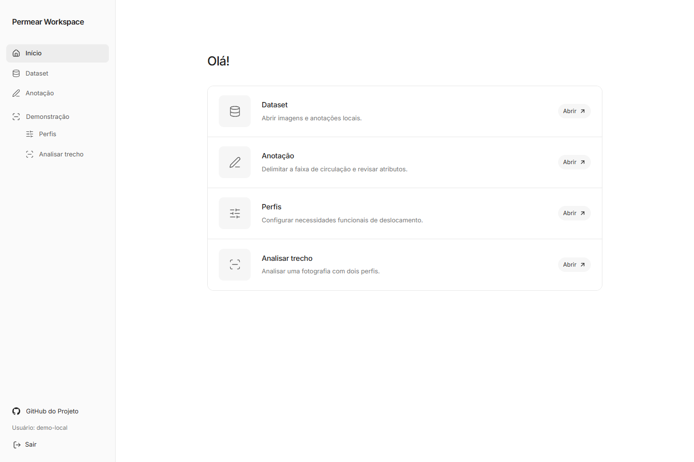
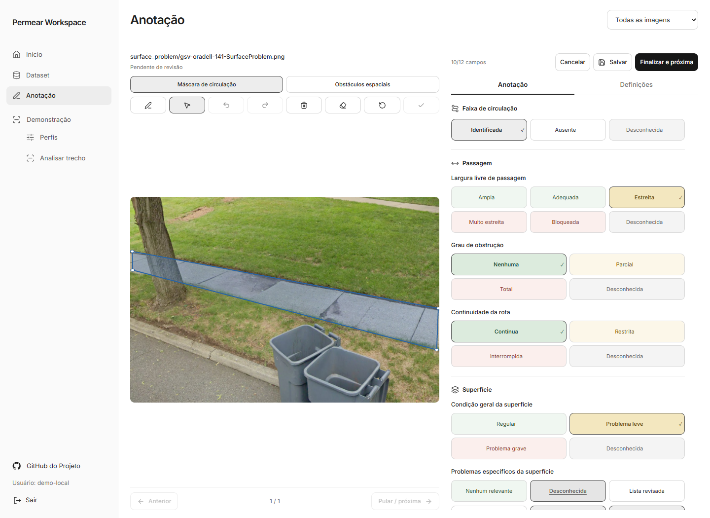
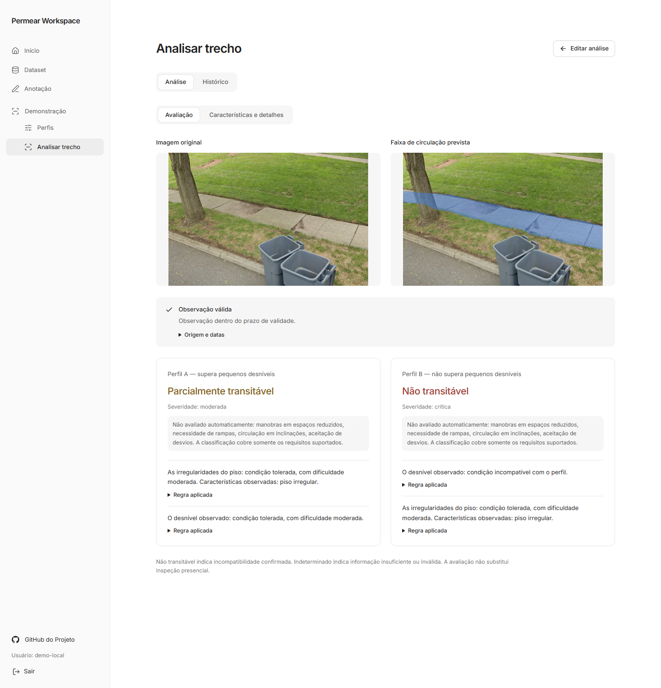
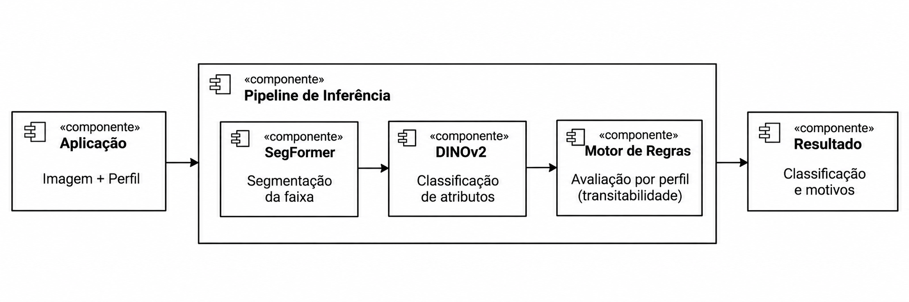

<h1 align="center">Permear</h1>

<p align="center"><strong>Visão computacional para avaliar a transitabilidade urbana conforme o perfil de usuários de cadeira de rodas.</strong></p>

<p align="center">
  <a href="#visão-geral">Visão geral</a> ·
  <a href="#workspace">Workspace</a> ·
  <a href="#arquitetura">Arquitetura</a> ·
  <a href="#resultados">Resultados</a> ·
  <a href="#execução-local">Execução local</a>
</p>

## Visão geral

O Permear identifica a faixa de circulação e as características de uma calçada, compara-as com um perfil funcional e apresenta uma avaliação com motivos explicáveis.

A versão funcional **V2** combina **SegFormer-B0**, **DINOv2 v2-partial** e regras determinísticas. O resultado pode ser **transitável**, **parcialmente transitável**, **não transitável** ou **indeterminado**.

## Principais módulos

- **Dataset e anotação:** imagens e CSVs locais, edição de polígonos, obstáculos, atributos e revisão.
- **Perfis:** necessidades funcionais de deslocamento em cadeira de rodas.
- **Demonstração:** avaliação de uma fotografia para dois perfis, com máscara, características e motivos.
- **Histórico:** persistência de perfis e avaliações no Supabase.

## Workspace

### Início



_Acesso aos módulos de trabalho e demonstração._

### Anotação



_Imagem fixa, edição de polígonos e seleção direta de atributos._

### Demonstração



_A mesma calçada, dois perfis e avaliações distintas. Data da observação simulada._

## Arquitetura



O SegFormer delimita a faixa; o DINOv2 identifica características; o motor aplica os requisitos do perfil. Uma única inferência atende aos dois perfis.

Origem e data de captura acompanham a observação. A validade inicial é de **24 horas**, configurável e experimental. Observações vencidas ou com data ausente, inválida ou futura retornam **indeterminado**.

## Resultados

Avaliação nas **29 imagens do teste comum**, com isolamento por panorama.

| Componente V2                 | Métrica           |       Resultado |
| ----------------------------- | ----------------- | --------------: |
| SegFormer-B0                  | IoU / Dice        | 0,5222 / 0,6861 |
| DINOv2 com máscara humana     | Macro F1 agregado |          0,3762 |
| Pipeline com máscara prevista | Macro F1 agregado |          0,3034 |

O teste não participou do treino ou da validação, mas já foi observado durante o desenvolvimento. [Resultados e limites de interpretação](docs/resultados.md).

## Execução local

Ambiente verificado: **Python 3.13.9**, **Node.js 24.11.0** e npm. Comandos em PowerShell; inferência em CPU por padrão.

**1. Instale as dependências.**

```powershell
git clone https://github.com/luiz-matoso/projeto-transformador-I.git
cd projeto-transformador-I
python -m venv .venv
.\.venv\Scripts\Activate.ps1
python -m pip install -r requirements-api.txt
npm ci --prefix frontend
```

**2. Configure o ambiente e o acesso.**

```powershell
Copy-Item .env.example .env
Copy-Item frontend/.env.example frontend/.env
python -m api.auth init
```

O comando solicita usuário e senha, grava somente o hash Argon2id e gera a chave JWT. Os arquivos `.env` são carregados automaticamente e ignorados pelo Git.

Preencha `SUPABASE_URL` e `SUPABASE_SECRET_KEY` no `.env` e aplique as migrations de `supabase/migrations/` em ordem. Perfis e demonstração com histórico dependem do Supabase; a anotação local não depende dele. A chave secreta é exclusiva do backend.

**3. Disponibilize os modelos.** Solicite ao mantenedor o pacote de inferência V2 e extraia-o na raiz:

```text
.modal-models/
├── segformer/
│   ├── best_segformer.pt
│   └── image_processor/preprocessor_config.json
└── dinov2/
    ├── best_dinov2_v2.pt
    ├── image_processor/preprocessor_config.json
    └── backbone_config/config.json
```

Os pesos não estão no clone. Os caminhos já constam no `.env.example` e podem ser ajustados no `.env`.

**4. Inicie em dois terminais.**

```powershell
python -m uvicorn api.main:app
```

```powershell
npm run dev --prefix frontend
```

Abra o [Workspace](http://127.0.0.1:5173) e entre com o acesso criado. A API oferece [documentação interativa](http://127.0.0.1:8000/docs).

Para desenvolvimento, testes e build:

```powershell
python -m pip install -e .
python -m unittest discover -s tests -q
npm test --prefix frontend
npm run build --prefix frontend
```

## Referências

- [Project Sidewalk](https://github.com/ProjectSidewalk/sidewalk-tagger-ai) — fonte das imagens urbanas.
- [SegFormer](https://arxiv.org/abs/2105.15203), Xie et al., 2021.
- [DINOv2](https://arxiv.org/abs/2304.07193), Oquab et al., 2023.

Protótipo experimental: não certifica acessibilidade nem substitui a avaliação presencial. Desenvolvido no Projeto Transformador I da PUCPR.
