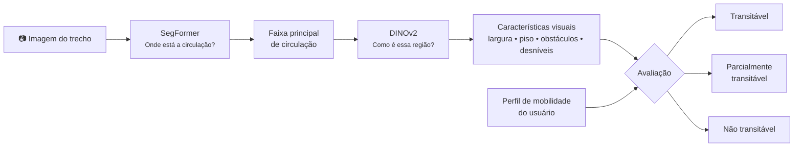
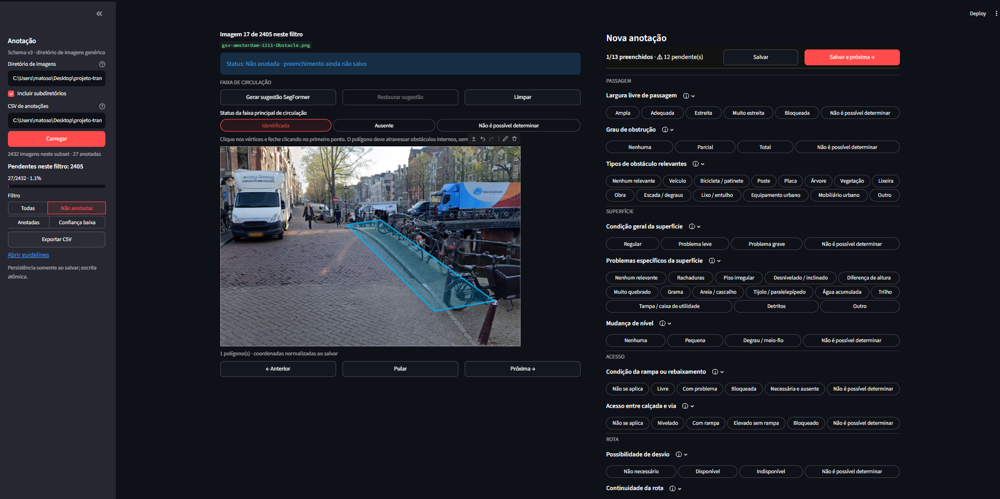
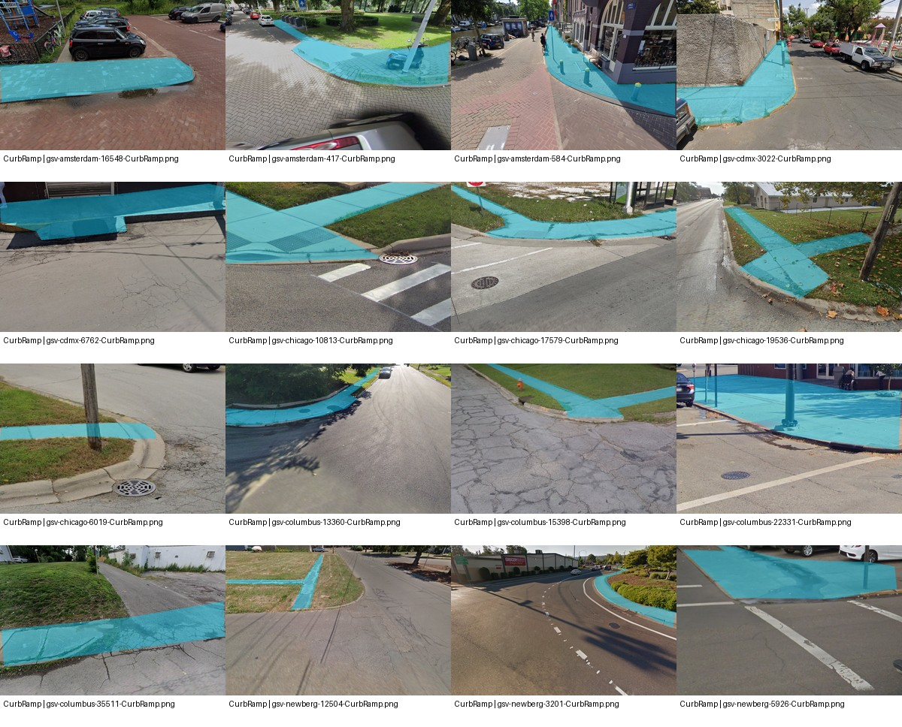
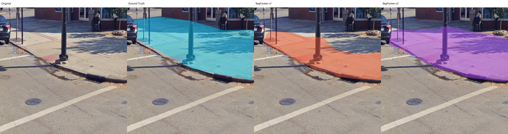
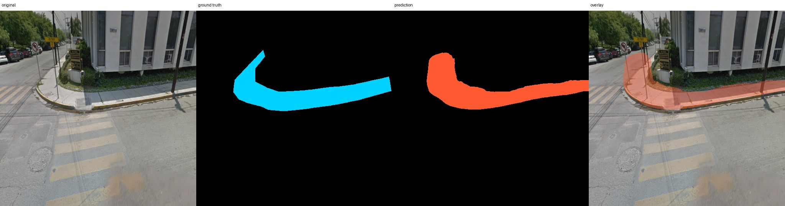
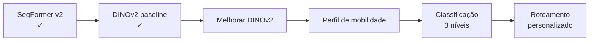

# Transitabilidade urbana para usuários de cadeira de rodas

> **Status técnico — 30/10/2026**

O projeto busca avaliar um trecho urbano a partir de uma imagem e, posteriormente, classificá-lo como **Transitável**, **Parcialmente transitável** ou **Não transitável** de acordo com o perfil de mobilidade do usuário.

---

## 1. O problema que estamos resolvendo

O primeiro protótipo utilizava uma **ResNet18** para detectar elementos como postes, árvores, veículos e vegetação.

Esse experimento mostrou uma limitação importante:

> **detectar um objeto não significa que ele interfere na circulação.**

Um poste pode aparecer na fotografia e estar fora da passagem. Da mesma forma, um veículo pode estar na rua e não ter qualquer impacto sobre a calçada.

Por isso, o problema foi dividido em etapas.

---

## 2. Arquitetura proposta

Os modelos possuem responsabilidades diferentes:

| Componente            | Função                                                          |
| --------------------- | --------------------------------------------------------------- |
| **SegFormer**         | localizar a região da imagem destinada à circulação             |
| **DINOv2**            | interpretar as condições visuais dessa região                   |
| **Perfil do usuário** | representar diferentes capacidades e necessidades de mobilidade |
| **Motor de decisão**  | combinar ambiente + perfil e gerar a classificação final        |

---

# 3. Construção do dataset

Foi criada uma ferramenta própria para anotar tanto as condições visuais quanto a **faixa principal de circulação (`circulation_path`)**.

O piloto atual contém **200 imagens** provenientes do Project Sidewalk:

| Tipo                    | Imagens |
| ----------------------- | ------: |
| Obstáculos              |      80 |
| Problemas de superfície |      70 |
| Rampas / meio-fio       |      50 |
| **Total**               | **200** |

Dessas imagens:

- **192** possuem uma faixa de circulação identificável;
- **8** foram marcadas como impossíveis de determinar visualmente.

Também são anotadas informações como:

**largura livre, obstrução, condição da superfície, desníveis, obstáculos e continuidade da rota.**

### Exemplos anotados

---

# 4. SegFormer — encontrar a faixa de circulação

O **SegFormer-B0** é utilizado para segmentação semântica.

Neste projeto, ele recebe uma imagem e deve separar:

| Classe | Significado                   |
| ------ | ----------------------------- |
| `0`    | restante da imagem            |
| `1`    | faixa principal de circulação |

Foi utilizado um modelo previamente ajustado para **cenas urbanas**, seguido de **fine-tuning** para nossa tarefa específica.

---

## Evolução do SegFormer

A primeira versão foi treinada com apenas **75 imagens**.

Após ampliar o dataset, uma segunda versão foi treinada com **162 imagens**, mantendo exatamente as mesmas imagens de validação e teste.

Isso permite comparar as versões de forma justa.

| Métrica   |     V1 |         V2 | Evolução |
| --------- | -----: | ---------: | -------: |
| **IoU**   | 0,4517 | **0,5572** |  +0,1055 |
| **Dice**  | 0,6223 | **0,7157** |  +0,0934 |
| Precision | 0,6125 | **0,6460** |  +0,0334 |
| Recall    | 0,6324 | **0,8023** |  +0,1698 |

### O que significam essas métricas?

| Métrica       | Interpretação                                                                 |
| ------------- | ----------------------------------------------------------------------------- |
| **IoU**       | interseção entre previsão e ground truth dividida pela união das duas áreas   |
| **Dice**      | mede a sobreposição entre as duas máscaras; `1,0` seria coincidência perfeita |
| **Precision** | quanto da área marcada pelo modelo realmente pertence à circulação            |
| **Recall**    | quanto da circulação real o modelo conseguiu encontrar                        |

O ganho mais forte ocorreu no **Recall**, indicando que o modelo v2 deixou de perder uma quantidade considerável da região correta.

### Comparação visual — V1 × V2

### Ground truth × previsão

O SegFormer ainda apresenta erros em alguns cenários, principalmente extensões além do ground truth ou regiões fragmentadas, mas o aumento de dados melhorou claramente sua capacidade de generalização.

---

# 5. DINOv2 — entender as condições do trecho

Depois de encontrar **onde está a circulação**, precisamos interpretar **como essa região é**.

Para isso está sendo utilizado o **DINOv2 ViT-B/14**, um modelo baseado em Vision Transformer que gera uma representação visual da imagem.

A região externa à `circulation_path` é atenuada antes de entrar no modelo, mantendo contexto da cena sem dar a mesma importância a áreas fora da circulação.

---

## Primeiro baseline

O primeiro experimento utiliza:

- **DINOv2 Base pré-treinado**;
- embedding visual de **768 dimensões**;
- backbone congelado;
- heads independentes para cada característica.

> **Backbone congelado:** nesta primeira versão, os pesos principais do DINOv2 não são modificados. Apenas as novas camadas de classificação são treinadas.

Foram utilizadas:

| Split          | Imagens |
| -------------- | ------: |
| Treino         |     134 |
| Validação      |      29 |
| Teste          |      29 |
| **Total útil** | **192** |

O modelo tenta prever sete grupos de características:

| Característica          |   Macro F1 |
| ----------------------- | ---------: |
| Largura de passagem     |     0,2632 |
| Grau de obstrução       |     0,1880 |
| Condição da superfície  | **0,4469** |
| Mudança de nível        |     0,2500 |
| Continuidade da rota    | **0,3435** |
| Tipos de obstáculos     |     0,2215 |
| Problemas de superfície |     0,2281 |

**Macro F1 médio: 0,2773**

> **Macro F1:** calcula o F1 de cada classe separadamente e depois tira a média, evitando que classes muito frequentes escondam o desempenho ruim das classes menores.

---

## O que o primeiro DINO mostrou?

O objetivo desse treinamento era obter um **baseline**, não um modelo final.

O melhor resultado de validação ocorreu já na **época 2**, seguido por overfitting.

Isso indica que:

- existe sinal de aprendizado em algumas características;
- o dataset ainda é pequeno para uma tarefa multitarefa desse tamanho;
- algumas classes possuem pouquíssimos exemplos;
- apenas treinar heads sobre o DINO congelado ainda não generaliza bem.

Exemplos de classes raras no dataset atual:

| Classe         | Exemplos |
| -------------- | -------: |
| Água acumulada |        1 |
| Trilho         |        2 |
| Detritos       |        2 |
| Utility panel  |        0 |

Portanto, o resultado atual serve principalmente para indicar **onde o dataset e o treinamento precisam melhorar**.

---

# 6. Estado atual

| Componente                          | Situação        |
| ----------------------------------- | --------------- |
| Ferramenta própria de anotação      | ✅              |
| Dataset piloto — 200 imagens        | ✅              |
| Ground truth da faixa de circulação | ✅              |
| SegFormer v1                        | ✅              |
| SegFormer v2                        | ✅              |
| DINOv2 baseline                     | ✅              |
| Melhoria do DINOv2                  | 🔄              |
| Perfil de mobilidade                | Próxima etapa   |
| Classificação em 3 níveis           | Próxima etapa   |
| Roteamento personalizado            | Etapa posterior |

---

# 7. Próximo ciclo

A próxima etapa experimental será avaliar:

- fine-tuning parcial do DINOv2;
- coleta direcionada de exemplos para classes raras;
- redução do desbalanceamento;
- quais características realmente podem ser inferidas de forma confiável a partir de uma única imagem.

O objetivo não é produzir uma classificação igual para todos, mas combinar **condições do ambiente** com **capacidades do usuário** para gerar uma avaliação personalizada da transitabilidade.
